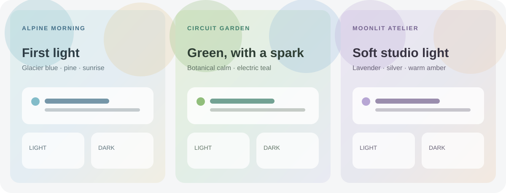

# Ambient Atlas

Three distinct Home Assistant dashboard themes with CSS-gradient backgrounds and coordinated light and dark palettes:

- **Alpine Morning** — crisp glacier blue, pine, and early sunlight.
- **Circuit Garden** — botanical green with a subtle electric teal accent.
- **Moonlit Atelier** — soft lavender, silver, and warm studio light.



These are palette illustrations, not Home Assistant screenshots. The backgrounds are generated entirely with CSS gradients. No remote images, custom cards, external fonts, or network requests are used.

## Install with HACS

1. In HACS, open **Frontend** and search for **Ambient Atlas**.
2. Download the theme and restart Home Assistant, or reload themes with the `frontend.reload_themes` action.
3. Open your user profile, select **Alpine Morning**, **Circuit Garden**, or **Moonlit Atelier**, and choose the light, dark, or system appearance.

If the themes do not appear, check that `configuration.yaml` loads the `themes` directory:

```yaml
frontend:
  themes: !include_dir_merge_named themes
```

Add this only if the directory is not already loaded. You can also add this repository in HACS as a custom repository of type **Theme**.

## Background behavior

Theme wallpapers use CSS gradients and do not require image files or `/local/` assets. A background set directly on a dashboard or view takes precedence over the theme background.

Each theme uses Home Assistant's built-in light/dark `modes`. Some component-specific colors may keep their defaults; these themes do not alter card layouts.

## Nederlands

Drie verschillende Home Assistant-dashboardthema's met CSS-kleurverlopen en bijpassende lichte en donkere kleuren:

- **Alpine Morning** — helder gletsjerblauw, dennegroen en ochtendzon.
- **Circuit Garden** — botanisch groen met een subtiel elektrisch teal-accent.
- **Moonlit Atelier** — zacht lavendel, zilver en warm studiolicht.

De afbeelding toont kleurillustraties, geen schermafbeeldingen van Home Assistant. De achtergronden bestaan volledig uit CSS-kleurverlopen. Er worden geen externe afbeeldingen, aangepaste kaarten, externe lettertypen of netwerkverzoeken gebruikt.

### Installeren met HACS

1. Open in HACS **Frontend** en zoek naar **Ambient Atlas**.
2. Download het thema en herstart Home Assistant, of laad thema's opnieuw met de actie `frontend.reload_themes`.
3. Open je gebruikersprofiel, kies **Alpine Morning**, **Circuit Garden** of **Moonlit Atelier** en selecteer de lichte, donkere of systeemweergave.

Verschijnen de thema's niet? Controleer dan of `configuration.yaml` de map `themes` inlaadt:

```yaml
frontend:
  themes: !include_dir_merge_named themes
```

Voeg dit alleen toe als die map nog niet wordt ingeladen. Je kunt deze repository ook in HACS toevoegen als aangepaste repository van het type **Theme**.

### Achtergrond en werking

De thema-achtergronden gebruiken CSS-kleurverlopen. Afbeeldingsbestanden of assets in `/local/` zijn niet nodig. Een achtergrond die je rechtstreeks op een dashboard of weergave instelt, heeft voorrang op de thema-achtergrond.

Elk thema gebruikt de ingebouwde lichte en donkere `modes` van Home Assistant. Sommige componenten kunnen hun eigen standaardkleuren behouden; de thema's passen de kaartindeling niet aan.

## License / Licentie

MIT. See [LICENSE](LICENSE).
